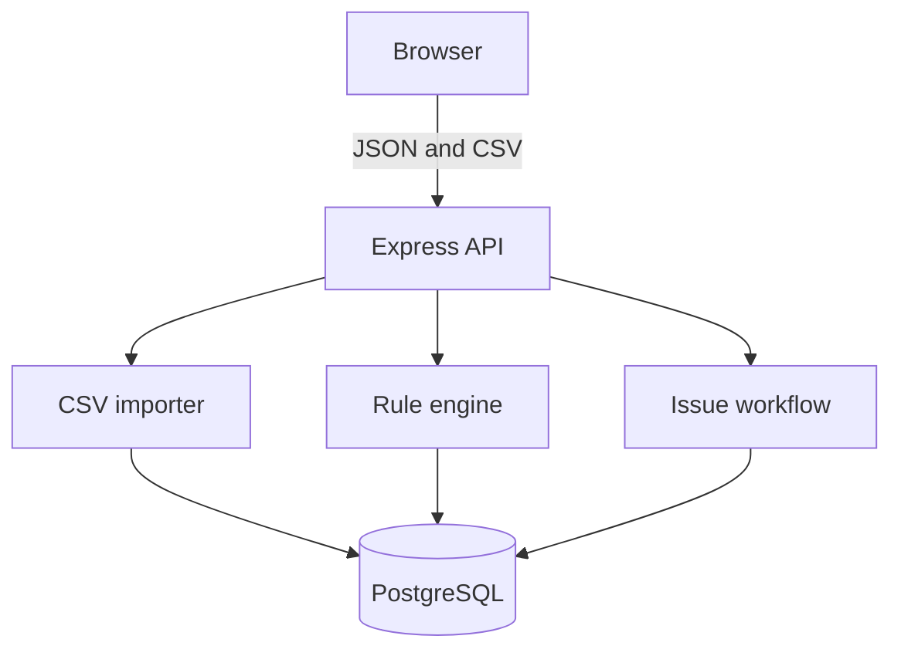

# ADR-000: Architecture overview

DataLint is a TypeScript application with a React client, an Express API, a rule engine, and PostgreSQL storage.

## Decision records

- [ADR-001: Modular monolith](adr-001-modular-monolith.md)
- [ADR-002: PostgreSQL](adr-002-postgresql.md)
- [ADR-003: Stable issue fingerprints](adr-003-issue-fingerprints.md)
- [ADR-004: Data model and issue lifecycle](adr-004-data-model.md)
- [ADR-005: System and trust boundaries](adr-005-system-boundaries.md)

`src/shared` contains the domain types used at the client and API boundary. `src/server` owns persistence and rule execution. `src/client` communicates with the server only through HTTP.
