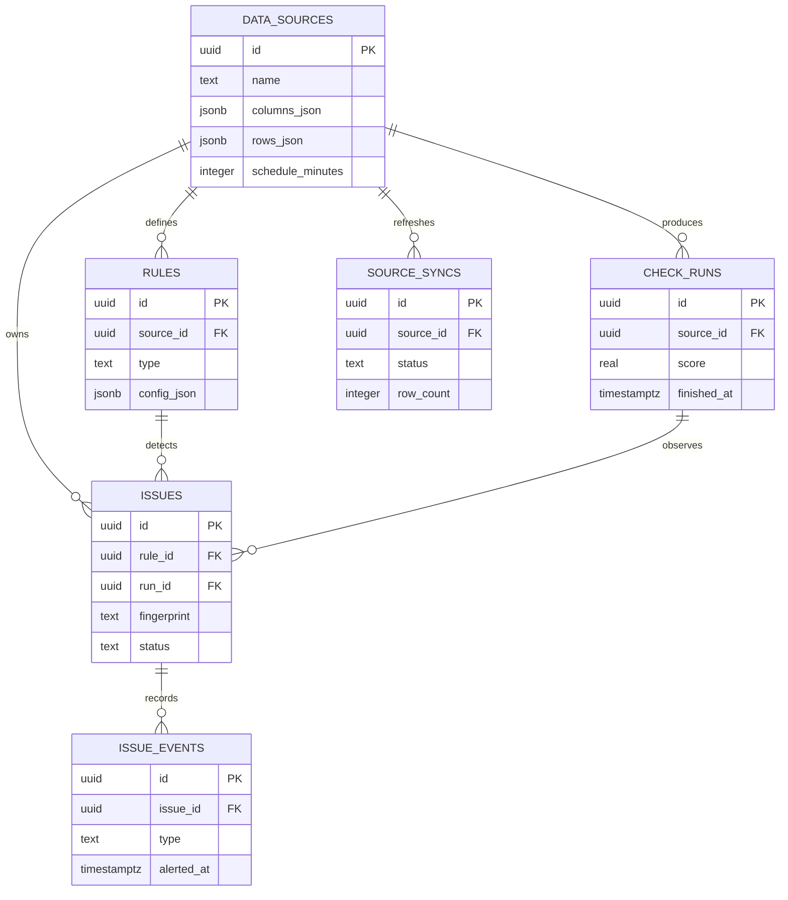
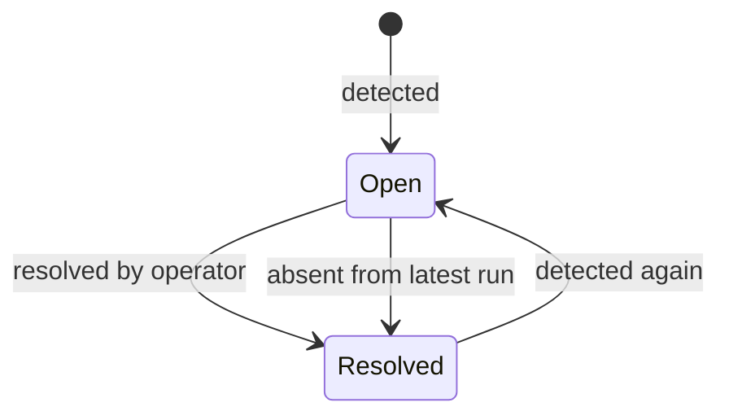

# ADR-004: Store checks as runs and durable issues

## Status

Accepted

## Decision

Keep imported snapshots, rules, check runs, and issues as separate relational records. Runs are immutable. Issues carry the current workflow state and point to the run where they were last observed.

Only rules that ran successfully may automatically close their existing findings. Every open, reopen, manual resolution, and automatic resolution is stored as an issue event.
