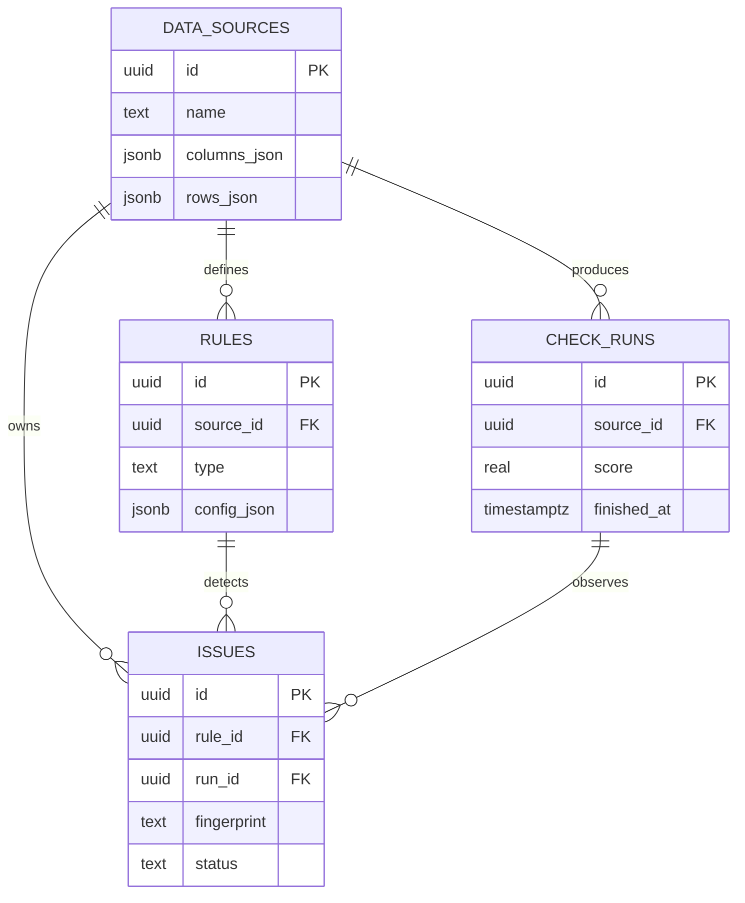
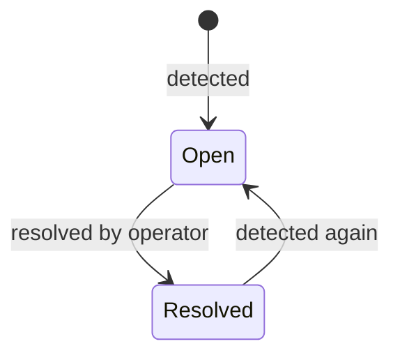

# ADR-004: Store checks as runs and durable issues

## Status

Accepted

## Decision

Keep imported snapshots, rules, check runs, and issues as separate relational records. Runs are immutable. Issues carry the current workflow state and point to the run where they were last observed.

The application does not automatically resolve a finding that disappears from a later run, because a missing row may represent an incomplete input rather than a correction.
