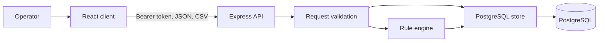

# ADR-005: Keep data access behind the API

## Status

Accepted

## Decision

The browser never connects to PostgreSQL. It uploads CSV files and sends rule or issue changes to the API, which validates each request before calling the store.

CSV content is treated as data and is never evaluated as code. Imported rows remain sensitive business data. Pattern rules execute as JavaScript regular expressions and therefore belong to trusted workspace configuration.
