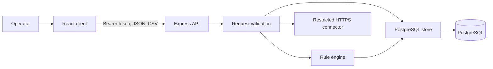

# ADR-005: Keep data access behind the API

## Status

Accepted

## Decision

The browser never connects to PostgreSQL or fetches remote sources directly. It sends source, rule, and issue changes to the API, which validates each request before calling the store.

CSV content is treated as data and is never evaluated as code. Imported rows remain sensitive business data. Pattern rules execute as JavaScript regular expressions and therefore belong to trusted workspace configuration.

Remote connectors accept HTTPS URLs without embedded credentials. They reject local and private-network destinations, limit redirects, response size, and request time, and normalize fetched values before storage.
