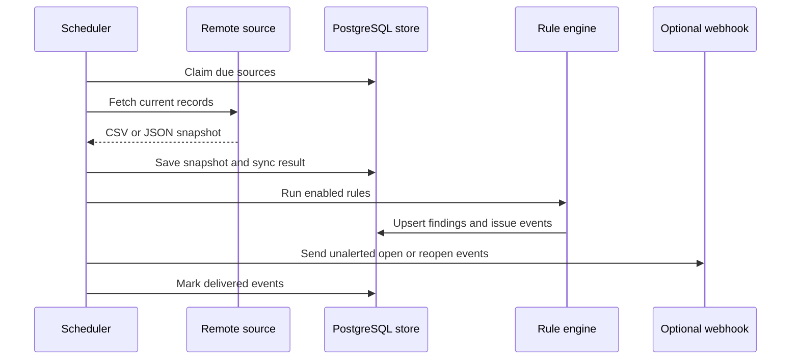

# ADR-006: Refresh snapshots before scheduled checks

## Status

Accepted

## Decision

Treat every CSV replacement or remote fetch as a source snapshot. Scheduled work claims due remote sources, advances their next-run time, refreshes the snapshot, and runs enabled rules only after a successful refresh.

The database is the coordination point. Advancing `next_run_at` during the claim prevents two scheduler processes from intentionally selecting the same work. Alert delivery uses issue-event rows as its deduplication ledger, so recurring checks do not repeatedly alert for an issue that remained open.

CSV sources remain manual because a browser-uploaded file has no refreshable remote location. Direct database connectors are outside this decision because they require encrypted credentials and stricter network isolation.
